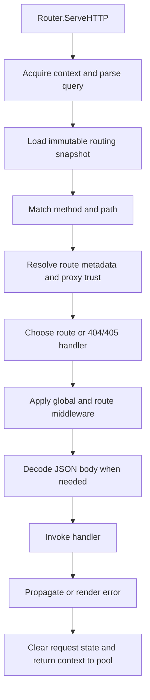

# Architecture and ownership

## Packages and dependency boundaries

The root `routix` package owns HTTP routing, request contexts, middleware, schemas, modules, and the API builder. `telemetry` imports the root package and external Prometheus/OpenTelemetry APIs. The root does not import `telemetry`.

`cmd/routix` is the executable. `commands` handles argument parsing and child processes; `generators` produces application source files. Generated projects use their own `go.mod`, configuration, database drivers, and startup lifecycle. A test that merely compiles a generator cannot establish that its emitted application builds or runs.

`test/test.go` is a library of testing helpers, not an automatically executed `_test.go` file. The `example` and `examples` trees demonstrate APIs but are not a complete specification.

## Request execution

The diagram describes synchronous ownership, not every middleware's control flow. Middleware can stop execution before body decoding or the handler. Timeout runs a handler on isolated state; cache can return a permitted cached response; recovery changes panic behavior.

`newRequestContext` prepares the public fields and an embedded `responseWriter`. Query decoding is skipped when `RawQuery` is empty. The router records the matched registered route pattern separately from the raw URL, so instrumentation can use bounded route labels.

`executeHandler` handles automatic JSON-body processing inside the middleware chain. `Context.ParseJSON` reads the same buffered content rather than consuming the original body again. Invalid JSON and excessive bodies become handler errors. Outer middleware can transform errors before `writeHandlerError` renders them.

## Registration and snapshots

`Router.handle` normalizes registration into segment nodes and stores parameter names on terminal routes. Shared parameter nodes must not overwrite terminal-route parameter identities. Re-registering an existing shape replaces its active route, metadata, handler, and middleware.

Registration, middleware updates, custom fallback handlers, and trusted-proxy updates invalidate `Router.dispatch`. `routingState` rebuilds a private snapshot under the router lock, copies the node graph and relevant slices, then publishes it through `atomic.Pointer`. An in-flight request continues using its snapshot. Future requests observe the rebuilt configuration. Snapshot creation is lazy, and server startup also prepares it.

Configure `MaxBodyBytes` and development settings before concurrent serving; the presence of snapshot locking does not make arbitrary writes to public fields safe.

## Matching layers

| Layer | Purpose | Safety boundary |
|---|---|---|
| Static index | Exact registered static paths | General matcher handles noncanonical paths |
| Terminal prefix index | Simple static-prefix + one parameter/wildcard | Eligibility excludes conflicting static descendants |
| Compressed prefix tree | Avoid repeated segment splitting/hash walks | Byte matching, bounded children, no decoded-path reinterpretation |
| Dense combined tables | Combine up to three suitable byte branches | Maximum 4096 slots; at least half occupied; no skipped terminal route |
| General matcher | Complex parameters, backtracking, slash variants | Semantic fallback and method availability checks |

Fast lookup cannot replace the routing contract with a different path-normalization policy. Tests must cover holes in dense tables, short paths, invalid bytes, Unicode, route replacement, and dynamic snapshot updates. Bounds failures return to ordinary matching; they must not produce another valid route through overflow.

HEAD checks its own routes first and then GET. Other missing methods scan path availability and build a sorted Allow header, including HEAD when GET exists. A path without any matching method uses the configured 404 handler. The router itself does not synthesize OPTIONS routes.

## Context and response lifetime

`sync.Pool` amortizes Context and its internally owned parameter map. `Context.Params` points to that map at request start but applications may mutate or replace the public field. Cleanup must empty the owned map as well as releasing the public fields. External replacement maps must not be silently reused as the next request's map.

Public Request/Writer/Response/Params/Query/Body references are released on pooled return. Private values, buffered body/error, handler, proxy-derived identity, and JSON writer state also need cleanup. The dirty marker covers the paths that change private state; any new private request mutation must either mark it or clean it synchronously before returning.

The embedded `responseWriter` records final response status and whether a response began. It forwards informational responses and supports response-controller unwrapping, flush, and hijack. Bypassing it through a raw underlying writer can invalidate status accounting.

JSON uses a temporary writer binding that restores prior state with defer, including reentrant encoding and panics. Headers/status are committed when encoded bytes are written, so encoding failure before output does not leave an empty 200 response. Existing JSON newline and HTML-escaping policies are observable behavior.

## Middleware ownership

`Use(A, B)` means A wraps B. Route/group/module middleware is scoped to those registrations. Global middleware also applies to fallback handlers. Middleware constructors can produce per-request state and must not be hoisted blindly into shared snapshots.

Timeout clones inherited response headers for its worker; a completed handler can add, replace, or delete them. A timed-out handler cannot leak later header changes into the returned response. A handler error without a written response is returned before any buffered success status is committed.

Timeout owns isolated request/response state for its worker. Completion may copy permitted values back; late workers must not touch a pooled parent or original response writer. Nested timeouts and parent deadlines share the earliest effective network read deadline. Cancellation is cooperative: Go cannot forcibly terminate arbitrary application work.

Compression owns a gzip writer that must close during panic unwinding as well as normal return. Recovery cannot turn a partially written response into a new clean error response; committed panic paths abort appropriately.

Cache and rate limiter hold process-local shared state. Cache exclusions include authorization/cookies, client certificates, request/response policy, and response variations. Route configuration and middleware ordering must not let cached responses bypass authentication.

## Security and observability

`proxy.go` separates socket peer parsing from forwarded-header interpretation. No proxy is trusted by default. A request snapshot fixes the relevant trust configuration while the handler runs. Use `Context.ClientIP`, not the legacy header-trusting helper, for security-sensitive decisions.

Readiness runs named dependency checks with a deadline and coalesces in-flight work per check. Checks should honor cancellation; the timeout does not kill a noncooperative function. Readiness exposes check state, not underlying secret-bearing error strings.

The builder installs process metrics through `PerformanceMonitor`. Those metrics use shared locking and are different from a bare Router benchmark. `telemetry` provides a registry-backed request counter, duration histogram, active-request gauge, and server spans. Configure an SDK/exporter separately; merely creating middleware does not configure an export destination.

## Contracts and validation

`Schema` is the common validation interface. Fluent schemas in `base.go`, struct-tag validation in `validator.go`, and contract conversion in `contract_schema.go` are related but do not yet have perfectly identical semantics. See the limitations document before extending rules.

`CodeGenerator.BindRouter` joins contract metadata with actual registrations. `contractRoutes` rejects metadata for missing registrations and duplicate method/path contracts. OpenAPI conversion validates its generated 3.0.3 document with kin-openapi. TypeScript consumes the same schema representation. No automatic introspection of a handler reveals arbitrary runtime response types.

`contract_source.go` loads Go source and resolves types rather than guessing field types from text. Recursive references, pointers, embedded fields, JSON tags, and unsupported/custom marshalers require deliberate contract handling. A source parser or generated contract does not automatically add runtime validation middleware.

## CLI and generated code

| Flow | Owner | External effects |
|---|---|---|
| `new` | commands/new + generators/project | Writes a project and resolves dependencies |
| `serve` | commands/serve | Watches files, builds and replaces child processes |
| `route:list` | commands/routes + route_list | Builds and runs application initialization, exports JSON |
| `test` / `build` | corresponding commands | Invokes Go subprocesses and returns failure |
| migration/seed | commands/database + generated database package | Executes generated runner against configured database |
| auth | generators/auth | Produces controllers, bcrypt/token services, models, migration |

`serve` serializes builds and tracks pending edits, adds watchers for new directories, ignores generated/output paths, and stops managed children during shutdown. Review cross-platform process behavior when changing it.

Migration runners need end-to-end tests for apply, rollback, history/checksum mismatch, concurrent locking, dirty state, and repair. MySQL DDL cannot be assumed to have PostgreSQL/SQLite transaction semantics. Auth needs persistence, revocation/refresh, credential-validation, secret, and concurrent-refresh tests against generated applications.
